 

### projects

  
  
  
  

more at <a href="https://bywilliaml.com/projects">bywilliaml.com/projects</a>

 

  
  
  
  
  
  
  
  
  
  
  

  

<picture>
  <source media="(prefers-color-scheme: dark)" srcset="https://raw.githubusercontent.com/byw1/byw1/output/contributions-dark.svg">
  
</picture>

<picture>
  <source media="(prefers-color-scheme: dark)" srcset="https://raw.githubusercontent.com/byw1/byw1/output/snake-dark.svg">
  
</picture>

 

